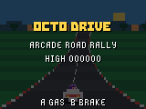
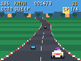

# Octo Drive

Race a bright pseudo-3D highway with Mona at the wheel in this original arcade road game for the GitHub Universe 2026 badge.

 

## How to play

Reach all four checkpoints before time expires. Checkpoints add time, passing
traffic adds points, and leaving the road scrubs speed. Traffic density rises
after every checkpoint, while cones, oil patches and barriers become more
frequent in later sections. Finish quickly for a larger time bonus and a saved
best time.

| Pad | Action |
| --- | --- |
| Left / Right | Steer |
| Select (A) or Up | Accelerate |
| Back (B) or Down | Brake |
| Menu | Pause or resume |
| Home | Quit to the badge menu |

The game runs in LORES (160x120), renders the road and cars with vector
primitives, and stores its high score and best finish time with
`badgeware.State`.

## Install

Connect a GitHub Universe 2026 badge with a USB-C data cable, install
`mpremote`, and run:

```sh
python3 install.py
```

The installer switches the badge into mass-storage mode, copies
`octo_drive/` to `/system/apps/octo_drive`, ejects the volume, and verifies the
installed files when the badge restarts.

## Development

```sh
python3 -m pip install -r requirements-dev.txt
python3 -m unittest discover -s tests
python3 tools/build_octodrive_assets.py
```

The race rules in `octo_drive/game.py` are badge-independent and covered by
host-side tests. The road, scenery, traffic and player car are rendered with
badge vector primitives. The 24x24 menu icon is generated, while the Mona
driver sprite is the attributed asset described below.

## Credits and license

Released under the MIT License. The Mona driver sprite is copied from
[Super Mona](https://github.com/martinwoodward/super-mona) and is derived from
the MIT-licensed Flappy Mona artwork in
[`badger/home`](https://github.com/badger/home), credited to Pimoroni and
GitHub.
